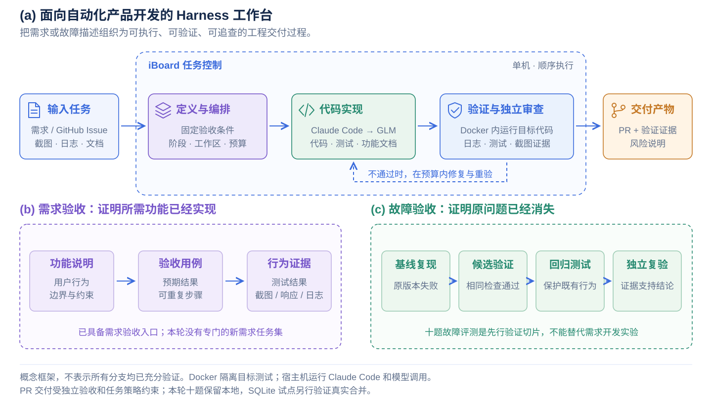
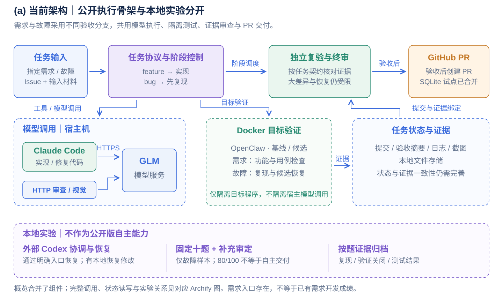
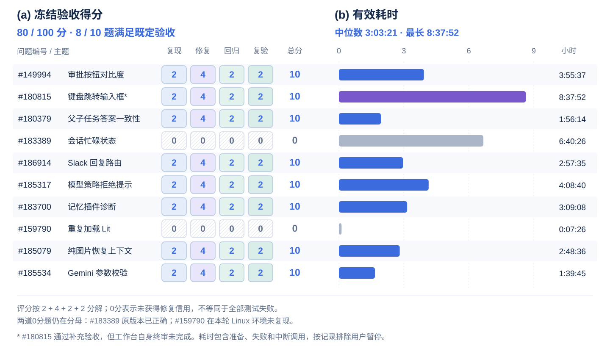
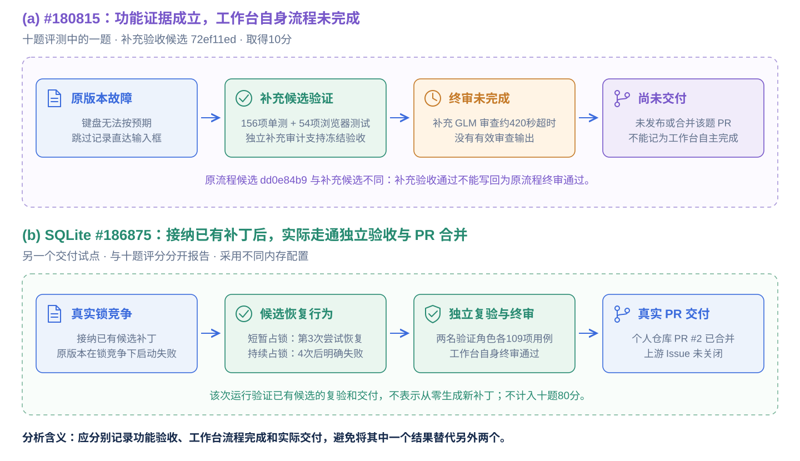
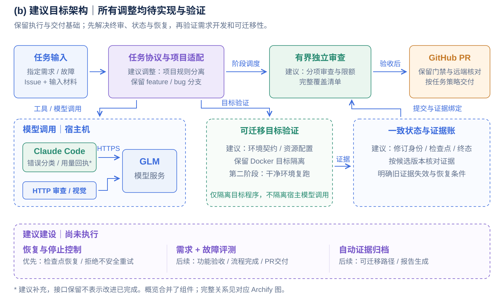

# iBoard：面向产品开发自动化的 Agent Harness 工作台

从需求与故障输入，到可验证的实现和 PR 交付

工程实验报告 · 2026年11月12日修订 · 实验材料截至2026年11月7日

<b>摘要</b>

iBoard 是一个面向产品开发自动化的 Agent Harness 工作台，用于组织智能体完成需求实现、故障修复、验证和 PR 提交。它承接的是一个产品开发任务，而不只是一次代码生成请求：输入既可以是功能需求，也可以是 Issue、截图和日志；输出应同时包含实现、验收证据和可追踪的交付结果。本报告将这一产品目标与目前的实验结果分开讨论。公开原型已提供需求与故障两类执行分支；本轮主要以 OpenClaw 十个固定故障验证实现与验收机制，八题满足预先固定的评分条件，总分80/100。独立的 SQLite 试点还完成了个人仓库 PR 的创建与合并。实验同时暴露了终审超时、恢复依赖外部协调和跨环境复现不足等限制。现有结果支持继续推进工作台，但尚不足以证明通用需求开发已经实现无人值守，也不能量化相对直接使用 Claude Code 的效率提升。下一阶段应以真实需求任务补齐端到端证据，并同步验证有界终审、中断恢复及跨机器运行。

关键词：产品开发自动化；Agent Harness；需求实现；独立验收；证据；PR交付

## 一、问题定义

### 1.1 实验背景：把产品开发任务交给智能体

iBoard 来源于自动化产品开发实验。实验的出发点是减少从“提出一个需求”到“形成可验收的代码变更”之间需要持续人工跟进的工作：澄清目标、理解工程、实现功能、准备测试、检查结果，再提交 PR。故障修复是这一过程的重要任务类型，但不是产品定义的全部。用户希望最终只需给出明确任务和约束，工作台能够推进实施，并报告结果与风险，而不必逐个审查 PR。[1]

这一目标要求系统持续维护任务上下文，而不能只在单次模型响应中生成代码。即使已有补丁，仍需确认需求是否完整覆盖、测试是否有效、证据是否对应最终提交，以及中断后能否正确继续。对产品开发自动化而言，完成的单位应是一个具有验收依据的任务，而非一段看似合理的代码。

本轮选择已有工程中的故障作为第一批验证对象。故障通常具有明确的原始行为，可以用修改前后的对照检查验收机制；固定源码起点也便于比较不同候选。**这一选择是实验切片，不意味着 iBoard 只是一个修 Bug 工具。** 更开放的需求任务仍需单独评测，尤其要检查功能说明、边界条件和交付内容是否完整。

### 1.2 产品定义与责任边界

**iBoard 是一个 Agent Harness 工作台：围绕编码智能体管理任务、工具、执行环境、验证、恢复和交付，使需求实现与故障修复形成可追踪的工程流程。** 当前以 Claude Code 为执行工具、GLM 为主要推理服务，以本地插件和 Python 工作流承载这些职责。[2]

工作台的产品输入是用户指定的需求或故障，以及必要的截图、日志和验收约束。产品输出是候选实现、功能或修复说明、测试与独立验收证据，以及对应 PR。满足已授权的交付策略时，可进一步合并到个人仓库。PR 提交属于产品的基本交付目标，自动合并是受策略约束的后续动作。

需求和故障共享任务、实现、验证与交付基础设施，但采用不同验收逻辑。需求应证明新能力满足功能说明；故障应先证明原问题存在，再证明最终候选解决问题。不能要求所有需求先“复现故障”，也不能把无法复现直接写成修复完成。

<figure id="fig-1" class="wide-figure">

<figcaption><b>图1｜iBoard 的产品框架与验收分工。</b> 顶部展示从任务输入到 PR 的共同过程，下方展开需求与故障的不同验收要求。这是依据产品目标和现有代码整理的概念框架；各条路径的实验成熟度并不相同。Docker 隔离目标程序验证，模型调用在宿主机侧执行。</figcaption>
</figure>

### 1.3 本报告回答的研究问题

本报告围绕三个问题展开。<b>RQ1：工作台能否组织智能体形成可验证的实现？</b> 本轮用十题故障评测回答其中的修复部分。<b>RQ2：验证之后，流程能否稳定完成独立审查和 PR 交付？</b> 对比未完成终审的题目与实际交付试点。<b>RQ3：这些机制能否推广到真实需求开发和其他工程？</b> 现有证据不足以回答，列为下一阶段的验证重点。

## 二、问题分析

### 2.1 需求正确性不能由“测试通过”单独决定

对需求任务，正确性来自功能说明与验收条件之间的对应关系。模型可能只实现主要路径，遗漏异常输入、交互状态或兼容行为；即使自行编写的测试通过，也不能据此证明需求完整。需要在实现前明确验收条件，并在实现后逐项核对功能文档、运行行为和测试证据。

对故障任务，测试还必须具有发现原问题的能力。如果同一检查在原始版本上已经通过，它就不能单独证明补丁有效。本轮 #183389 在固定基线上已有正确行为，#159790 则未在固定 Linux 环境中复现。两题均保留0分和调查记录，未作为修复成功处理。[3]

### 2.2 实现、验证与交付具有不同完成条件

代码已经修改、相关测试通过、独立审查完成、PR 已提交，是不同阶段的事实。若用一个“完成”字段代替这些阶段，就可能把功能验收误写成完整交付。#180815 的补充验证支持修复评分，但工作台自身终审未完成；SQLite 试点则取得了真实合并回执。这一差别应体现在状态、指标和报告中。

独立验证者的作用是复查执行者的判断，并在独立运行中检查结果。分角色执行可以降低仅凭作者自述验收的风险，但不自动保证结论正确：两个角色仍可能使用同一模型家族、同一测试脚本，遗漏共同的边界条件。因此，角色分离必须与原始证据、负例检查及可重复命令配合。

### 2.3 长任务的主要困难也包括状态和恢复

任务会逐步产生计划、代码、测试脚本、日志、截图和审查结果。它们可能在不同时间写入，模型或运行器也可能在任一阶段退出。恢复时必须判断哪些内容仍有效，哪些操作已经在远端完成，以及候选变化后哪些测试需要重跑。仅重试上一次命令，既可能遗漏验证，也可能重复交付。

因此，iBoard 需要把可检查的验收条件、候选身份和执行证据作为流程的一部分。本轮已有相关机制，但恢复仍覆盖不全，实验中需要 Codex 协调恢复、补强验证或处理进程。此处的外部介入不等于人手修改目标工程代码。

## 三、解决方案

### 3.1 以验收条件组织两类任务

当前入口接受 `bug` 与 `feature` 两类任务。工作台保存输入、验收条件、Git 起点、工作目录和预算，再由模型生成执行计划。故障任务进入基线复现；需求任务从规划直接进入实现，同时必须指定功能文档。候选完成后，两类任务均执行相关检查、独立复验与终审。[2]

表1｜两类任务的验收与交付要求

| 任务类型 | 实现前的依据 | 最终候选的必要证据 | 交付材料 |
|---|---|---|---|
| 需求实现 | 功能描述、明确验收条件；不强制故障复现 | 功能文档、测试结果、独立审查；界面截图或无界面运行日志 | PR关联已验证提交及功能文档 |
| 故障修复 | 固定基线中的问题复现与独立确认 | 问题消失、相关回归、独立审查；截图或运行日志 | PR关联复现、解决及测试证据 |

失败后允许在任务预算内继续修复；无法复现、验收不充分、环境异常或预算不足时，应保留记录并停止推进。验收条件如需修改，必须说明原因和依据，不能为得到通过结果而降低标准。本轮十题的总时间和迭代上限字段均为空，仍有单次操作超时；不能套用此前另一任务的“7次、60小时”限制。厂商明确拒绝额度时被动停止，恢复由用户决定。

### 3.2 当前实现：宿主机编排与目标程序隔离

Python 工作流管理阶段，调用 Claude Code 通过 GLM 生成修改或进行只读检查。除此之外，Python 还可直接请求 GLM，用于可由所提供材料完成的终审和视觉分析。两条调用路径承担不同工作，不应把所有模型调用画成经由 Claude Code。[2,4]

Docker 执行基线和候选的目标程序验证，并限制网络、内存和进程资源。正式十题串行运行，单容器内存上限3072 MiB。模型服务请求在宿主机侧发出，Docker 边界不包含全部智能体活动。当前实现也不是一个已经验证过的多任务并行调度平台。

<figure id="fig-2" class="wide-figure architecture-figure">

<figcaption><b>图2｜As-Is：当前代码与本地实验的架构边界。</b> 正文概览依据同一组件清单绘制，将公开执行骨架与实验协调分开标注；完整关系保留在 Archify 图中。两种图均区分需求／故障分支、模型调用路径及目标测试隔离边界。<a href="paper/architecture/iboard_as_is.archify.html">打开可交互架构图</a>。</figcaption>
</figure>

### 3.3 证据绑定与 PR 交付

验证记录保存命令、镜像、候选提交、执行者、退出状态和日志；界面任务还需截图。证据哈希用于确认文件身份，独立审查负责判断其是否满足验收条件。哈希一致本身不能证明测试有效，也不是不可篡改的安全保证。

发布前，工作台检查最终候选与证据的对应关系，再核对远端分支及适用策略。需求 PR 中的功能文档链接绑定已验证提交；故障 PR 包含复现、解决和测试记录。合并及关闭 Issue 还需满足各自条件，上游 Issue 不因个人 fork 合并而自动关闭。十题评测有意保留本地候选，评分结果不等于交付结果。[5]

### 3.4 实现范围与实验范围

公开原型已有两类任务入口、模型适配、目标隔离、证据门禁与 PR 发布逻辑。功能分支“代码存在”并不等于“真实需求端到端已验证”。本轮可靠运行证据主要来自故障修复；恢复补丁、证据修订和补充审定还分散在不同本地版本中。[4]

因此，本报告评价的是公开原型与本地实验修改共同参与的过程，不是一个固定公开发行版的盲测。未来能力仅在第六部分以建议呈现，不计入当前成果。

## 四、实验结果

### 4.1 设计、条件与指标

十题均来自同一 OpenClaw 固定题集，各题从 `54710b1…` 独立开始。模型配置为 `glm-5.3[1M]`，通过 Claude Code 2.1.285 调用。实验采用 `pr-assisted` 条件，允许参考或接纳已有补丁；工作台版本及验证方法在过程中发生调整。该设计适合检查流程与证据，不能解释为在完全未知答案的条件下独立解决十个新问题。[3]

每题总分10分，由复现2分、修复4分、回归2分和独立复验2分组成，阶段之间有前置依赖。有效耗时包含记录内的准备、失败和中断调用，按记录排除用户暂停；它不是统一定义的“收到任务至交付”的完整等待时间。所有测试结论限于实际记录的验证范围，不代表全量 CI 通过。

### 4.2 十题结果

八题满足预先固定的验收条件，总分80/100；另外两题未获得修复分。十题有效时间中位数为3小时3分21秒，最长为8小时37分52秒。共有474次可观测容器执行，包括失败、诊断和复跑；这一数字不是模型调用次数。文本 token 与费用字段为空，现有材料无法计算实际成本。[3]

<figure id="fig-3" class="wide-figure">

<figcaption><b>图3｜十题的阶段评分与有效耗时。</b> 分数与耗时来自已核对的固定快照，未因本次改版重新运行实验。#183389 为基线行为正确，#159790 为未复现，两题保留在分母中。#180815 的补充验收得分与其原流程终审状态分别记录。该图不表示需求开发成功率，也不表示相对其他方案的提升。</figcaption>
</figure>

表2｜逐题成绩、有效耗时与主要限制

| 问题 | 评测结果 | 有效耗时 | 主要验证范围或限制 |
|---|---|---|---|
| [#149994 浅色主题审批按钮文字对比度](data/evidence-index.md#local-evidence) | 通过，10分 | 3:55:37 | 界面及相关测试；未跑完整CI |
| [#180815 键盘跳过聊天记录](data/evidence-index.md#local-evidence) | 补充验收通过，10分 | 8:37:52 | 156项单测、54项浏览器测试；原流程终审未完成 |
| [#180379 子任务答案一致性](data/evidence-index.md#local-evidence) | 通过，10分 | 1:56:14 | 双角色77项及22项补充测试；外部恢复和验证补强 |
| [#183389 会话提升后的忙碌状态](data/evidence-index.md#local-evidence) | 基线行为正确，0分 | 6:40:26 | 两次3072 MiB行为检查；不计修复分 |
| [#186914 Slack延迟回复路由](data/evidence-index.md#local-evidence) | 通过，10分 | 2:57:35 | 路由回放与本地接口；未连接真实Slack |
| [#185317 模型策略拒绝提示](data/evidence-index.md#local-evidence) | 通过，10分 | 4:08:40 | 真实子任务逻辑与模拟网关；未验证在线模型回合 |
| [#183700 记忆插件可用性检查](data/evidence-index.md#local-evidence) | 通过，10分 | 3:09:08 | 真实诊断与加载；部分不可用情形由环境模拟 |
| [#159790 Lit重复加载警告](data/evidence-index.md#local-evidence) | 未复现，0分 | 0:07:26 | 固定Linux未见警告；未重建历史macOS环境 |
| [#185079 图片历史恢复上下文](data/evidence-index.md#local-evidence) | 通过，10分 | 2:48:36 | 真实SQLite、双角色150项；类型检查仍有既有错误 |
| [#185534 Gemini参数校验](data/evidence-index.md#local-evidence) | 通过，10分 | 1:39:45 | 离线验证；无在线Gemini或Code Mode guest执行 |

两道0分题没有从分母中剔除。完整候选提交、退出状态、测试限制及三类证据目录保留在[技术附件](technical-notes.html)。目录名称“验证关闭”不表示远端 Issue 已关闭。

### 4.3 功能验收与交付的两种结果

#180815 的补充候选通过156项单测、54项浏览器测试及独立检查，支持10分评分。但原流程保留的候选与补充验收候选不同，原流程并未完成终审。后续针对补充候选的 GLM 审查约420秒后超时，无有效输出，也未交付。截图来自真实 OpenClaw 界面，网关与聊天数据经过模拟；画面中的 `gpt-5.5` 只是测试标签，不证明实际调用该模型。[6]

另一个 SQLite 试点 #186875 接纳此前已有补丁，重新进行真实锁竞争复现、独立验收与交付。基线网关启动失败；候选在短暂锁释放后于第3次尝试恢复，持续占锁时4次尝试后仍明确失败。两名验证角色各跑109项防护用例，最终个人仓库 PR #2 创建并合并。该试点使用7168 MiB内存设置，不属于十题成绩，也不是此次重新从零生成补丁；上游 Issue 未关闭。[7]

<figure id="fig-4" class="wide-figure">

<figcaption><b>图4｜验收结果与交付结果必须分别判断。</b> 两例显示相同的“测试通过”不能替代终审与远端回执。上方案例属于十题评测，下方属于独立交付试点；候选来源、内存设置及统计分母均不合并。</figcaption>
</figure>

## 五、结果分析

### 5.1 对产品目标的支持程度

对于 RQ1，本轮在选定故障范围内支持“工作台能够组织实现和形成可复查证据”：八题取得完整评分，两题未取得复现基础时保留0分。对于 RQ2，SQLite 试点表明限定条件下可以完成真实 PR 交付；#180815 则表明独立终审仍可能阻断后续流程。对于 RQ3，需求分支已有实现，但缺少与本轮同等强度的真实需求端到端证据，不能据此宣称产品开发全流程已经自动化。

成绩支持继续完善 Harness，同时要求把功能验收、原流程完成和远端交付分别统计。十题保留本地是实验策略，不能把未交付十题解释为交付能力为0%；反过来，也不能用另一个已合并试点替代十题的交付记录。

### 5.2 当前主要瓶颈

**终审材料与执行预算尚未稳定匹配。** #180815 的完整差异约126468字节，超过公开实现30000字节差异上限。本地提供完整材料后，补充审查仍超时。现有证据只能确认审查未完成，不能确定是输入组织、模型响应还是网络因素单独导致。

**恢复状态尚未形成统一解释。** 状态、代码和证据分散保存，部分恢复依赖现场判断。SQLite 试点的流程已完成，但预算控制字段仍可显示运行中。该现象不表示任务仍在执行，也没有实际数据丢失的证据；它说明接手者难以只凭一个状态字段判断后续操作。

**公开版本的可重复性仍不足。** 实验使用了本地恢复版本和补充审定，尚未由一个统一公开版本在第二个干净环境完整复跑。当前机器成功不能直接外推为其他使用者安装即得同等结果。

### 5.3 效度与解释限制

本轮样本经过选择，允许参考已有补丁，工作台版本随实验调整，且没有“直接Claude Code”对照组。因此，基线失败与候选通过证明目标代码行为发生变化，不能单独识别 Harness 的因果贡献，也不能计算效率提升百分比。

原统计中的“保守自主完成2/10”仅筛选得10分且未被标记外部干预的题目；即使未标记，也可能存在协调帮助。6/10的外部干预包含恢复、补强验证和终止进程，并非六题由人手编写修复代码。这些字段不能直接作为无人值守率或人工改码比例。

部分验证使用模拟网关或离线接口，未覆盖真实外部服务；现有时长也不是完整交付等待时间。由于缺少可用费用记录、统一介入耗时和重复全轮实验，现阶段只能报告观察结果，不能声明更快、更省或统计显著。外部 Harness 的既有机制对比留在[技术附件](technical-notes.html)，本轮没有运行同题竞争评测。

## 六、下一步改进验证

### 6.1 用真实需求任务补齐产品定义的证据

下一轮首先补充两类小需求：一类界面交互需求，一类无界面功能需求。它们应来自明确的产品任务，不使用工作台开发过程中已经反复调试过的答案。每题在执行前固定功能说明、验收条件和原有功能防护；完成后核对实现、功能文档、测试证据及 PR 是否对应同一候选。

建议把“功能验收通过”“工作台自身流程完成”“PR成功提交”作为三个独立结果。界面题附实际截图，无界面题附请求响应或日志。任何外部介入均记录操作、原因和耗时。两题只用于确认需求链路能够运行，不据此估计通用需求成功率。以下各项均为后续建议，尚未执行。

### 6.2 优先验证终审、恢复与环境迁移

终审实验沿用 #180815 同一候选与完整证据，对比单次审查和按验收清单分项审查。两种方式各运行3次，交错执行；每次正例最多20分钟，分项上限5分钟，六次正例总上限120分钟，不含准备和负例。补充“缺少关键差异材料”及“证据文件被改动”两个负例，要求拒绝通过。记录覆盖项、终审输出、超时位置和外部介入，不能通过删减必读材料换取完成。

恢复实验在准备任务、修改代码、写入证据、发布前和发布后五类位置各制造2次中断。验收要求能解释停留阶段、不丢失已有证据、不重复提交或合并，且脚本改变后使受影响旧证据失效。不确定状态可以停止并说明原因，远端操作使用演练仓库。

迁移实验固定一个整合版本，在第二台干净机器上按说明运行一道界面任务和一道无界面任务。过程不依赖当前 Codex 对话历史；正常配置凭据，但不复制本机密钥。记录安装、环境准备及验收过程中仍需补充的现场知识。

<figure id="fig-5" class="wide-figure architecture-figure">

<figcaption><b>图5｜To-Be：围绕下一轮可检验目标的演进方案。</b> 本图为论文概览，全部属于建议设计，完整关系另见 Archify。保留执行与隔离基础，优先调整验收、终审和恢复；跨项目与并发位于后续阶段，不能读作当前已经实现。<a href="paper/architecture/iboard_to_be.archify.html">打开可交互目标架构图</a>。</figcaption>
</figure>

### 6.3 用受控对照回答是否提效

保留原十题作为回归集，另选未用于开发调试的新需求和新故障。比较直接使用 Claude Code 与使用 iBoard，两组固定模型、工具、预算及环境，不参考已有修复，由不知道方案标签的评审按相同条件验收。分别比较功能结果、原流程完成、PR交付、端到端耗时和外部介入；仅记录厂商实际提供的用量，费用不可得时保留未知。

在单任务稳定后，再验证第二工程和两题并发。前者检查是否能通过有限适配复用流程，后者检查资源排队、单题停止与证据隔离。当前不以扩大 Agent 数量替代上述验证。

### 6.4 结论

iBoard 的定位是服务于产品开发自动化的 Harness 工作台，需求实现、故障修复与 PR 交付共同构成产品范围。现有代码具备这一流程的基础，故障评测提供了八题验收通过和一个独立试点真实合并的证据；同时，终审、恢复与迁移仍限制其独立运行能力。下一阶段的关键不是把80分改写为普遍能力，而是用真实需求任务、统一版本和受控对照，逐步验证它能否减少从需求到交付的持续跟进工作。

<h3>材料与引用</h3>

[1] 产品定位依据：用户关于自动化产品开发、需求实现、故障修复及PR交付的明确要求；既有任务与验收约定见 <a href="README.md">当前工程上下文</a>。本报告未将产品愿景写成已验证性能。

[2] 两类任务实现：<a href="https://github.com/leewbl/iBoard/blob/effc347df42f45037dad0a4bbe2a2cb7e53d363a/workbench/start.py">start.py</a>（144–153行），<a href="https://github.com/leewbl/iBoard/blob/effc347df42f45037dad0a4bbe2a2cb7e53d363a/workbench/autopilot.py">autopilot.py</a>（737–767、942–949行），<a href="https://github.com/leewbl/iBoard/blob/effc347df42f45037dad0a4bbe2a2cb7e53d363a/workbench/cli.py">cli.py</a>（247–256行）。公开代码分析基准为effc347；行号按本地核对版本。

[3] 固定评测：<a href="data/metrics.json">机器可读指标</a>、<a href="data/evidence-index.md#local-evidence">最终快照</a>及<a href="data/evidence-index.md#local-evidence">十题证据目录</a>。本次只整理与绘图，没有重跑模型或产品测试。

[4] 实际架构与版本：<a href="README.md">工程上下文</a>、<a href="data/architecture-diagnosis.md">架构诊断</a>、<a href="https://github.com/leewbl/iBoard/blob/effc347df42f45037dad0a4bbe2a2cb7e53d363a/model/claude_glm.py">Claude Code适配器</a>和<a href="https://github.com/leewbl/iBoard/blob/effc347df42f45037dad0a4bbe2a2cb7e53d363a/runner/sandbox.py">Docker运行器</a>。

[5] 交付逻辑：<a href="https://github.com/leewbl/iBoard/blob/effc347df42f45037dad0a4bbe2a2cb7e53d363a/workbench/publish.py">publish.py</a>（功能文档与PR正文，398–407行）、<a href="https://github.com/leewbl/iBoard/blob/effc347df42f45037dad0a4bbe2a2cb7e53d363a/workbench/delivery.py">delivery.py</a>及<a href="https://github.com/leewbl/iBoard/blob/effc347df42f45037dad0a4bbe2a2cb7e53d363a/workbench/local_gate.py">local_gate.py</a>。

[6] #180815：<a href="data/evidence-index.md#local-evidence">补充独立审计</a>、<a href="data/evidence-index.md#local-evidence">约420秒终审超时回执</a>。

[7] SQLite试点：<a href="https://github.com/leewbl/iBoard/blob/effc347df42f45037dad0a4bbe2a2cb7e53d363a/evidence/openclaw-186875-local-validation.json">公开证据摘要</a>，以及历史回读确认的<a href="https://github.com/leewbl/myopenclaw/pull/2">myopenclaw PR #2</a>。此处沿用已归档记录，不声称本次重新查询远端。

